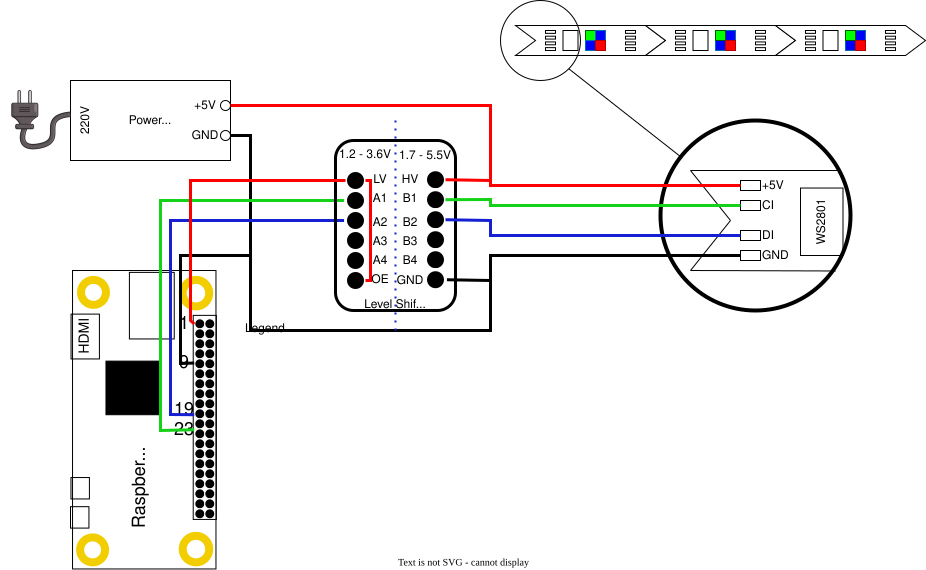
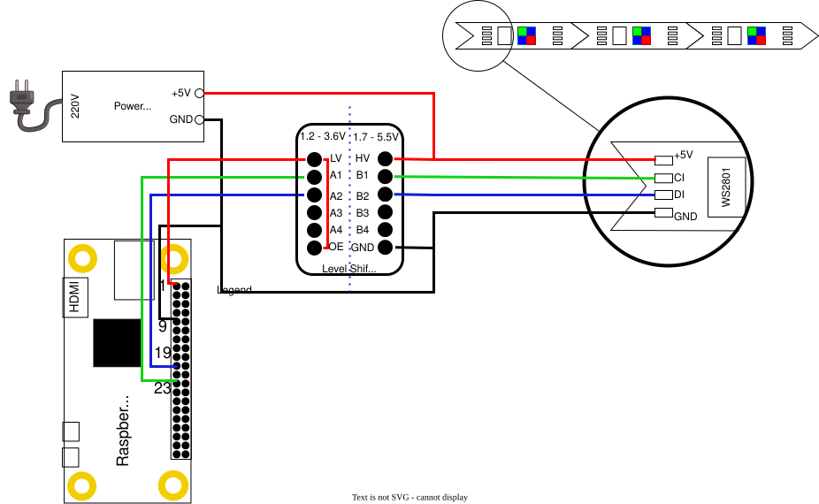
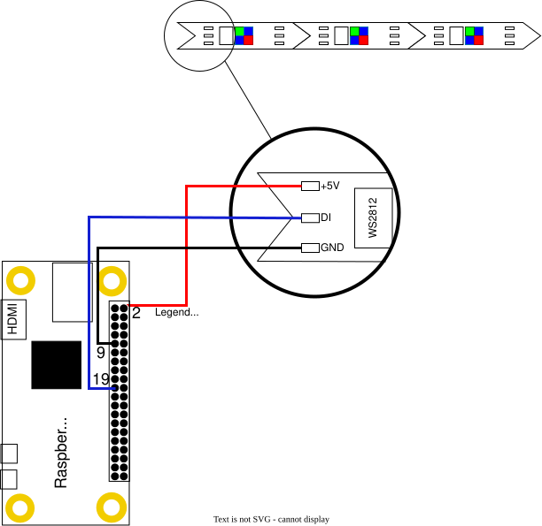

<!--
Copyright 2023, Matthias Reik <fledex@reik.org>

SPDX-License-Identifier: Apache-2.0
-->

# Hardware (examples)
## Introduction
This is a short description what you need to do on hardware side and how
to connect the Raspberry Pi (RPI) with the LED strip.
The description consists of 2 parts, the first one without a level-shifter
the second one with a level shifter


> #### Caution {: .warning}
> 
> YOU MUST BE A QUALIFIED ELECTRICIAN TO CONNECT TO HIGH/DANGEROUS VOLTAGES (> 30V)
> 
> NO RESPONSIBILITY CAN BE TAKEN FOR ANY DAMAGE CAUSED BY FOLLOWING THIS GUIDE

## Hardware components (example)
* Raspberry Pi Zero W (with pin header)
* LED strip with a [WS2801 chip](https://cdn-shop.adafruit.com/datasheets/WS2801.pdf) ([e.g. this one on Amazon](https://amzn.eu/d/cPdgigY))
* 5V Power supply, powerful enough to power the LED strip (e.g. [Mean Well LPV-35-5](https://www.meanwell.com/webapp/product/search.aspx?prod=LPV-35) for a 3m strip)
* (optional) [Level shifter](https://www.ti.com/product/TXB0104?qgpn=txb0104) in a easy to use format (e.g. [the one from Adafruit](https://www.adafruit.com/product/1875))
* cables, soldering iron, plugs, ...

> #### Note {: .info}
>
> You will have to adjust your shopping list to the led strip you actually buy.
> The example given here is for an WS2801. Other led strip types are similar, but you
> have to watch out to adjust to the specs of your led strip. 
> 
> **Example:** A [WS2815](https://www.ledyilighting.com/wp-content/uploads/2025/02/WS2815-datasheet.pdf) is powered with 12V (instead of the usual 5V). Thus, you will require a different power supply.
> 
> Fledex currently only supports the SPI bus, but it would be easy to write a driver for 
> other bus types.
>
> It should also be noted that the wiring of LED strips is not standardized and you
> can even find descriptions like the [following](https://www.adafruit.com/product/6024):
> "Note: Connecting to these is a little tricky because there are no power/data markings
> (there's no PCB!). The female connector is usually on the input end. The red wire is 
> V+ power, the middle (green) wire is ground, and the last wire (black) is data in. 
> Double check with alligator clips before you solder, since this can be inconsistent 
> with different lots."

## SPI and WS2801 
We are connecting the LED strip with the Raspberry Pi through the [SPI (Serial Peripheral Interface)](https://en.wikipedia.org/wiki/Serial_Peripheral_Interface). The SPI has 4 logical signals, but we are only interested in 2 of them.

* Clock (SCLK)
* Master Out, Slave In (MOSI)

The [WS2801](https://cdn-shop.adafruit.com/datasheets/WS2801.pdf) uses a very simple protocol via SPI. It uses as a bus where one LED will pass on the message to the next LED, removing the first information from the message. 

The following two signals are not used:

* Chip Select (CS)
* Master In, Slave Out (MISO)

This is because we neither address every chip individually nor do the chips provide any response. The LED strip usually doesn't even expose those signals.

If you look carefully, you can find on the LED strip a DI (Data In) and DO (Data Out) pins. They indicate in which direction the signals are flowing. The same also applies to the CI (Clock In) and CO (Clock Out) pins. 

When you connect your Raspberry Pi you will have to connect the MOSI (of the RPI) to the DI (of the LED strip) and the SCLK (of the RPI) to the CI (of the LED strip).

In the following we will look at two ways to connect the LED strip to the RPI, one directly (which probably works, but is not recommended) and one with a so called level shifter.

The reason for the level shifter is that the RPI (even though it's powered with 5V) uses 3.3V for its SPI port. The LED strip is powered with 5V and expects a 5V signal. We should adjust between the two voltage levels.

The driver that you should use for the WS2801 is the [`Spi.Ws2801`](`Fledex.Driver.Impl.Spi.Ws2801`) driver. If you wire it following this description, you can use the default values, so the only thing you need to do is:

```elixir
led_strip :name, Spi.Ws2801 do
    # ... here comes you strip definitions
end
```

## SPI and WS2812 (and compatible strips)
The hardware setup for a WS2812 led strip is very similar to the WS2801. We power it also through the SPI port, but there is no need to wire the clock. The clock information is embedded within the signal itself. 

### Background information
The following information should help you to use this diver for a strip 
that is compatible, but might require some tweaking.

To embed the clock singal, Every bit is encoded within 3 bits. 

* `0`: is encoded as `100`
* `1`: is encoded as `110`

To fulfill the requirements we need to run the bus at a much higher frequency (2.6MHz).  The specs are setting a theoretical limit on how many updates we can run. For a WS2812 this limit is:
* physical bit length: `1/2_600_000Hz = 0.38μs/physical bit`
* locical bit length: `10.38μs/physical bit * 3 physical bits/logical bits ≈ 1.14μs/logical bit`
* pixel length: `1.14μs/logical bit * 8 locical bit/color * 3 color / pixel ≈ 27.36μs/pixel`
* max number of pixels per second: `2_600_000 Hz / 27.36μs/pixel ≈ 95.000 pixel`
* wait between transfers (reset): `>80 μs`
* max number of pixels with 30 frames/sec: `(27.36μs/pixel * x*pixel + 80μs) = sec / 30 frames` ==> `x ≈ 1200`

Those are just rough estimations but give an idea on how many pixels you can drive with a decent refresh rate (i.e. with animations). It should also be noted that some limitations might come from your underlaying system. On [Goatmire 2026](https://goatmire.com/) it was demonstrated that Fledex can drive 900 leds.

You might want to adjust the [buffer limit, default of 4096 defined in `/sys/module/spidev/parameters/bufsiz`](https://www.sigmdel.ca/michel/ha/rpi/spi_on_pi_en.html). 

### Setup and supported led strips
If you are using the WS2812 strip and follow the wiring described here, then you can use the [`Spi.Ws2812`](`Fledex.Driver.Impl.Spi.Ws2812`) driver with the default settings. You then define your led strip as:

```elixir
led_strip :name, Spi.Ws2812 do
    # ... here comes you strip definitions
end
```

If you want to use another (but compatible) led strip, you will have to adjust the settings according to the table below:

```elixir
led_strip :name, {Spi.Ws2812, [options]} do
    # ... here comes you strip definitions
end
```
| Type   | Options              | Tested | Notes |
|:-------|:---------------------|:------:|:------|
| [WS2805](https://www.superlightingled.com/PDF/WS2805-IC-Specification.pdf) | `led_type: :rgbw1w2` |        | The extra white leds can be used either by using the `Fledex.Color.RGBW` module or through a `colorint` with `0xw2w2w1w1rrggbb` |
| [WS2811](https://www.ledyilighting.com/wp-content/uploads/2025/02/WS2811-datasheet.pdf) | `led_type: :rgb`     |        | |
| [WS2812](https://www.ledyilighting.com/wp-content/uploads/2025/02/WS2812B-datasheet.pdf) | `led_type: :grb` (default)  | 👍 | [WS2812 and WS2812b are the same from a protocol perspective](https://cdn.sparkfun.com/assets/learn_tutorials/1/0/5/WS2812B_VS_WS2812.pdf) |
| [SK6812](https://www.normandled.com/upload/201603/SK6812%20LED%20%20Datasheet.pdf) | `led_type: :grb`, `led_type: :brg`, or `led_type: :grbw` | 👍 | There seems to be different variations out there. Tested with [Adafruit NeoPixel Pebble](https://www.adafruit.com/product/6024) (`:brg`) |
| [WS2813](https://www.ledyilighting.com/wp-content/uploads/2025/02/WS2813-RGBW-datasheet.pdf) | `led_type: :grbw`    |        | The extra white led can be used either by using the `Fledex.Color.RGBW` module or through a `colorint` with `0xwwrrggbb` |
| [WS2814](https://suntechlite.com/wp-content/uploads/2024/06/WS2814-IC-Datasheet_V1.4_EN.pdf) | `led_type: :grbw`    |        | (same as WS2813) |
| [WS2815](https://www.ledyilighting.com/wp-content/uploads/2025/02/WS2815-datasheet.pdf) | `led_type: :grbw`    |        | (same as WS2813) |

`Tested` means that the driver has been tested with real hardware. The other have only been implemented according to the spec. Please provide feedback if you can confirm that they actually work. 

> #### Note: {: .info}
>
> The default `:delay_us` should work for all supported strips

## Finding the pins on the RPI

It can be quite tricky to find the correct pin on the RPI. Therefore several resources are linked below. The difficult part is to figure out where pin 1 is located, everything else is then quite easy.
The below drawing tries to make it clear on how you have to look at your RPI. You look from the the top down onto the processor (black) and then you can easily find pin 1.

## Direct Connection

The direct connection (especially with short connections) will probably work, because the allowed tolerance for a HIGH signal. We will still be above the required 2V. Any signal above 2V is considered as HIGH (= binary a 1) and any signal below 0.8V is considered as LOW (= binary a 0). 



## Connection via a Level Shifter
It is better to use a level shifter to properly translate between the 3.3V signals and the required 5V signals.

There are [different ways](https://electronics.stackexchange.com/questions/82104/single-transistor-level-up-shifter/82112#82112) on how to level shift. We will use the Adafruit TXB0104 Bi-Directional Level shifter. It is a bit of an overkill, because we neither need to translate in both direction, nor do we require 4 signal lines, but it's easy to work with.

You have to do the following steps:

1. Connect the higher voltage and lower voltages to HV and LV respectively. This tells the level shifter to which levels we want to translate. It's important to make sure that the lower voltage is on the LV side and the higher voltage on the HV side.
2. Connect each signal line to one of the signal pins. The 3.3V to the LV side (A1-A4) and the 5V to the corresponding pins on the HV side (B1-B4).
3. Enable the output by connecting the OE pin (output enabled) to the LV pin
4. Connect all the ground lines to the GND pin.



## Powering the LED strip from the RPI
You can connect smaller LED strips also directly to a RPI, as long as your power supply
can provide the necessary power

> The 5V power pins are connected directly to the Pi's power input and will 
> capably provide the full current of your mains adaptor, less that used by the Pi itself.
> (see: https://pinout.xyz/pinout/pin2_5v_power/)

This setup is probably not the most stable, but for experiements and for short wires
should really get you going. Just make sure you have a solid 5V (or ideally even slightly above) power supply that doesn't dip in voltage depending on the load. 

Here the wiring example of a WS2812:


## Additional Information
### Useful information about NeoPixels
* https://learn.adafruit.com/adafruit-neopixel-uberguide


### Other procols:
* DMX512: After my talk `Driving LEDs with Fledex` on Goatmire 2026, I got a question whether I considered to implement a driver for the [DMX512 protocol](https://en.wikipedia.org/wiki/DMX512), common in BIG installations. I did take a look at it and if I understood it correctly it does not allow to control the individual LEDs. They all would have the same color. You do have 512 channels, so you could hang every LED onto a separate channel, but you would need 3-4 channels per LED and this would limit the number of LEDs. So yes you could write a driver, but I  don't think this is very practical. If you have more experience with DMX and would see a use case I'm happy to discuss :-)
*  ArtNet: The same applies also to [ArtNet](https://art-net.org.uk/downloads/art-net.pdf), a variation of DMX512, that removes some of the limitations.

### Level Shifter:
* https://electricfiredesign.com/2021/03/12/logic-level-shifters-for-driving-led-strips/

### Pin information:
* https://pinout.xyz/pinout/spi# 
* https://www.raspberrypi.com/documentation/computers/raspberry-pi.html
* https://pi4j.com/1.2/pins/model-zerow-rev1.html

### Logic Levels
* https://learn.sparkfun.com/tutorials/logic-levels/all

